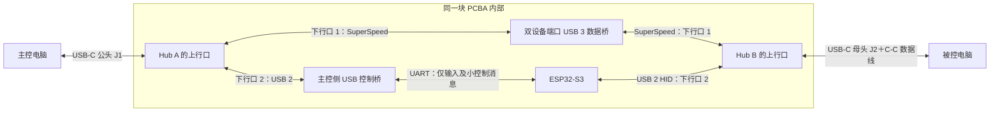

# 双 USB-C 高速键鼠共享设备：打板前可行性审查

> 历史 USB 3 备选方案：当前采用单 CH32V407 双 USB 2.0 HS 候选，见 [PCBA 需求规格书](PCBA_REQUIREMENTS.md)。本文的 Hub/USB 3 桥架构、性能目标及旧软件状态不作为当前设计或采购依据。

日期：2026-10-30（Asia/Singapore）。性质：理论分析、现有源码核对、公开一手资料审查。**不是原理图批准、样机测试报告或采购指令。**

## 1. 决策

**产品架构可行；现阶段不具备 PCBA 下单条件。**

一端 USB-C 公头插主控，另一端 USB-C 母头通过 C-C 数据线接被控，两端各占一个电脑接口。内部使用两个独立上行的 USB Hub，分别接高速数据桥和键鼠设备，能够在同一块 PCBA 上实现。文件字节不经过 ESP32，也不占用键鼠串口。

决定是否打板的未决项不是“USB 能否同时传文件和键鼠”，而是：桥接固件/协议能否取得并供本产品使用、两端驱动和程序实测、文件满载时的输入延迟，以及单板供电/热/信号设计。不能用芯片标称速率代替这些证据。

| 判断对象 | 当前结论 | 证据边界 |
|---|---|---|
| 一公一母、仅两个外部接口 | 原理成立 | 不是无源延长线；是两个主机各连接一个设备端 |
| 键鼠与高速文件并行 | 原理成立 | USB 2 与 SuperSpeed 分路；主机资源和电源仍可能共用 |
| 保留当前 ESP32-S3 | 可以 | 用于输入、边缘控制、配对和被控端安装资源 |
| 当前开发板只改固件达到 USB 3 文件速度 | 不成立 | 当前大文件路径含 UART 与 S3 Full-Speed |
| PL27A1 直接定型 | 尚不能 | 可作为候选；固件、协议、现代系统及供货未闭环 |
| 当前 0.6.2 直接支持 GB 文件 | 不成立 | 当前文件入口限 1 MiB，接收依赖完整内存对象 |
| 任意电脑、任意负载下绝对零延迟变化 | 无法保证 | macOS/Windows 及其主机控制器不是本设备独占 |
| 不打定制板先验证核心风险 | 可以 | 两个成品 USB 3 Hub、候选数据桥、当前 ESP32 即可搭建同拓扑 |

本报告按最新“一公一母”要求编写。旧 `wiredkvm_s3_inline_revA.md` 的固定尾线公头、尺寸和功耗假设不适用于本设计，不能沿用它下单。

## 2. 硬件拓扑与证明



HA、HB 是两颗各有自己上行口的 Hub，分别属于不同电脑的 USB 总线。BR 的两个端口都是 USB Device，内部转发数据。因此不存在“两个 USB Host 接在普通 Hub 的同一个上行口”的冲突，也不需要让任一电脑切换成 USB Device 或目标磁盘模式。

USB5742B 的官方资料明确描述其 USB 2 控制器和 SuperSpeed 控制器并行工作；每侧两个内部下行口足够容纳一个桥端口与一个控制设备。它是可行性参考器件，尚未因本报告成为冻结 BOM。[Microchip 数据手册，第 6 页](https://ww1.microchip.com/downloads/aemDocuments/documents/UNG/ProductDocuments/DataSheets/USB5742B-Data-Sheet-DS00002016.pdf)

正常高速工作时，两台电脑上数据桥均须枚举为 SuperSpeed。键鼠保留 USB 2 路径。不能把数据桥的 USB 2 回退引脚与 MCU 的 D+/D−直接并接；两者各接不同 Hub 下行口，保持标准设备拓扑。

暂不采用“省掉 Hub，把同一个连接器的 USB 2 接 MCU、SuperSpeed 接另一个芯片”的分拆捷径。它涉及端口配对、供电申报、回退、挂起和认证语义，现有证据没有证明能作为本产品的标准实现。只有具体桥方案已经集成并公开支持 Hub/HID 功能，才考虑减少芯片；先降低研发风险，再比较物料成本。

被控端没有 Companion 时，主控软件仍能通过控制桥→ESP32→HID 操作它，随后用这套键鼠点击设备内的安装器。前提是主控软件已安装、已获系统要求的输入权限，且被控系统允许该 USB 配件连接。这不意味着在锁屏、企业策略或 USB 配件授权限制下也能无条件注入输入。

## 3. 键鼠为何不会被大文件占满，以及仍需隔离的资源

### 3.1 可以从结构上消除的争用

- 文件走 BR 的 USB 3 批量传输，不进入 ESP32 RAM、Flash 或 UART。
- 键鼠经过独立控制桥、UART 与 S3 的 HID 端点。桥接固件不承担 HID 调度。
- 当前两个键鼠 HID 端点的轮询描述符为 1 ms，保留其端点和拖选行为。
- 配对/版本/粘贴事务消息可以走现有控制通道，但必须定长、有界、限频；不能偷偷把文件降级回 UART 挤占输入。

USB Bulk 本身没有预约带宽；主机优先调度时间敏感的 Interrupt/Isochronous 请求。但这只说明 USB 总线调度，**不能推导出任意主机软件负载下输入必定准时**。[Microsoft Bulk/Interrupt 说明](https://learn.microsoft.com/en-us/windows-hardware/drivers/usbcon/usb-bulk-and-interrupt-transfer)

特别注意：主控侧 USB 串口/CDC 通常也用 Bulk。若整个连接降为 USB 2，它不自动享有 HID Interrupt 的调度待遇。产品必须识别任一侧的降速状态，限速或暂停文件任务，重新验证延迟；不能把 SuperSpeed 分路结论套到 USB 2 回退场景。

### 3.2 必须在实现中隔离的共享资源

| 资源 | 需要的设计 |
|---|---|
| 主控输入回调 | 只捕获、整理、入队；不得等待文件、磁盘、哈希或桥接 ACK |
| 主控/被控 CPU | 文件传输独立进程或独立工作队列；输入保持及时调度，不盲目启用实时优先级 |
| 内存与锁 | 文件缓冲固定上限；输入不持有文件锁、不等待内存扩容 |
| 磁盘 | 有界预读和写入队列；后台文件任务不得使 UI/输入线程同步等待 |
| 异常恢复 | 只取消文件请求/重置数据桥叶设备；不 reset 整个 Hub 或 ESP32 |
| 供电 | 数据桥故障支路可单独限流/关闭；避免文件负载变化拖低 HID 电源 |
| 初次安装 | 安装资源只读，不能为了更新安装盘重启正在控制的 HID |

因此，“不影响”落实为**满载测试下没有输入丢失、卡键、边缘返回回归，且额外延迟在验收范围内**。共同外部接口被拔掉、主机崩溃或 Hub 整体掉电属于连接故障，不能宣称键鼠还能继续控制被控机；此时必须及时恢复主控本机输入。

## 4. 当前瓶颈与理论数量级

本地核对点：`native/clipboard_channel.hpp`、`native/wk_protocol.hpp`、`native/wiredkvm.cpp`、`host/clipboard/WKClipboardProtocol.swift`、`firmware/main/usb_hid.c`。

| 项目 | 推导/已有记录 | 解释 |
|---|---|---|
| UART 921600、8N1 | 92,160 B/s | 已扣起止位，尚未扣应用协议 |
| 当前文件有效负载/串口帧 | 40/141 字节 | 64 字节 HID 报告经十六进制和帧校验封装 |
| 当前协议不含 ACK 等额外开销的上限 | 约 26.1 kB/s | `92160 × 40 / 141` |
| 再保留现有 25% 键鼠带宽 | 约 19.6 kB/s | 不是实测吞吐；还有确认、调度等开销 |
| 当前 512 KiB 实测 | 出站 12.43、回站 13.91 KiB/s | 既有 0.6.2 记录，本次没有重跑硬件测试 |
| 最大坐标 WK1 帧 | 27 字节；UART 发出约 0.293 ms | 只算串行线时间，非端到端输入延迟 |
| 假设每秒 1000 个此类坐标帧 | 占该方向 UART 约 29.3% | 尚需控制帧余量；不是已验证 1000 Hz 输入能力 |

文件离开串口后，即便只达到几十 MB/s，也已比当前路径快多个数量级。新数据桥的吞吐应按下式评估：

`R = min(两端 USB 可用吞吐、桥内部持续吞吐、驱动/应用吞吐、源读盘、目标写盘/校验)`。

5 Gbps 接口不能写成 625 MB/s 文件速度；以 Gen 1 的 8b/10b 编码估算，未计 USB 包和应用开销前约 500 MB/s，实际还会降低。该数值是带宽算术，不是对 PL27A1 的性能承诺。[USB 3.0 规范原文存档](https://forums.parallax.com/discussion/download/125344/USB%203%200%20%2811132008%29-final.pdf)

计算保存在 `results/high-speed-two-port-theory-20261030.json`，实测引用 `results/macmac-build12-20261030/acceptance.json`。过去独立雷雳/有线网络的数百 MB/s 记录不构成本 USB 桥方案的测速证据。

UART 例子也不覆盖大量额外按键、修饰键和重试叠加时的峰值；最终固件需明确报告合并规则和最长队列等待时间。USB 2→Full-Speed 的 Hub 事务转换、串口驱动缓冲和主机事件调度均需计入实际输入延迟。

## 5. 数据桥选型：有明确候选，还没有冻结型号

PL27A1 数据手册列出双设备端口及多种固件模式：27A3 为 CDC/ACM，27A7 为自定义传输，27A5 为 RNDIS。27A1 模式还列出约 12 MB 只读应用盘。[Prolific 数据手册，第 5–7 页](https://www.prolific.com.tw/wp-content/uploads/2025/07/DS-27131201-PL27A1_V1.5.pdf)

| 候选路线 | 本项目判断 | 必须取得的证据 |
|---|---|---|
| 27A7 自定义 USB Bulk | 优先验证高速路径 | 固件、端点/控制请求协议、流控、取消、独立两端复位行为 |
| 27A3 CDC/ACM | 可快速验证跨平台原始字节链路 | 固件实际可获取，USB 3 枚举，DTR/RTS/波特率语义及持续吞吐 |
| 27A1 配套厂商软件 | 可作商业参考 | 厂商软件传文件成功不等于我们的 Companion 能接入 |
| 27A5 RNDIS | 不作为 Mac/Windows 统一首选 | 公开资料没有给出 Mac 原生 RNDIS 支持保证 |

27A3 虽呈现“串口”，不必经过物理 UART，因此不能套用本板 921600 的速率上限；但也不能据此保证其驱动和固件达到 USB 3 满速。

Windows 可通过正确的设备描述符自动绑定 WinUSB，CDC 类也有系统驱动；Mac 的自定义 USB 访问可评估 IOUSBHost 应用层接口。**Mac 不使用 WinUSB 驱动**，不能照抄厂商资料里的笼统表述。是否能以普通签名应用、无需系统扩展完成访问，需要实际 USB 描述符和设备验证。[Microsoft WinUSB](https://learn.microsoft.com/en-us/windows-hardware/drivers/usbcon/automatic-installation-of-winusb)、[Microsoft CDC](https://learn.microsoft.com/en-us/windows-hardware/drivers/usbcon/usb-driver-installation-based-on-compatible-ids)、[Apple IOUSBHost](https://developer.apple.com/documentation/iousbhost)

本次找到的公开材料没有闭合：可用的 27A3/27A7 固件文件、完整自定义协议、量产使用条件、当前 Apple Silicon/Windows 11 兼容测试和供货报价。产品页部分空白下载链接还指向无关文档，不能当作 SDK 已取得。应取得厂商具体文件和版本后再决定购买哪种开发样品。

**备用路线**：两侧各一个 USB 3 千兆网卡控制器，内部通过符合 PHY 要求的以太网链路连接，ESP32 控制路径不变。AX88179A 官方列出 Mac 原生 CDC-NCM 与 Windows 支持，可作为候选。这会限制到千兆链路上限，并增加 PHY 连接、电源、空间和网络接口测试，未必更便宜；不能直接短接两组 PHY 引脚或假定可省磁性器件。网络只在设备内直连，不需要 Wi-Fi、路由器或互联网。[ASIX 官方资料](https://www.asix.com.tw/en/product/USBEthernet/Super-Speed_USB_Ethernet/AX88179A)

## 6. Type-C、公母头和供电：必须独立完成设计

J1 公头和 J2 母头均面向电脑 Host，数据角色都是 UFP。插头外形不决定 Host/Device 角色，J2 不能因为是母头就按给外设供电的 DFP 配置。

- J1 按选定 USB-C 公头/UFP 插件的 pinout 与正反插规则设计，不照搬母座双 CC 接法。
- J2 需独立 CC/Rd、VBUS 检测及 SuperSpeed 正反插切换；CC 不跨接到 J1。
- 两边 USB 数据均由 Hub/桥各自终止；不是把 D+/D−、SS 对或 VBUS 直通。
- 首版以合格 5 Gbps 被动 C-C 数据线为验证基线；充电线/USB 2 线只提供降级能力。不同插入方向和线缆方向都要测试。
- 第一版不要求给电脑充电，不需要为了数据传输加入高电压 PD 功能。实际供电电流仍必须服从 CC 公告/枚举状态。

这些 UFP 功能有标准实现路径，母座方向切换可用独立 CC 检测和高速 MUX。TUSB320 仅作为功能参考，不代表已按现行产品要求选定该器件。[Microchip UFP 应用说明](https://www.microchip.com/content/dam/mchp/documents/OTH/ApplicationNotes/ApplicationNotes/00001914B.pdf)、[TI CC 控制器资料](https://www.ti.com/lit/ds/symlink/tusb320.pdf)

供电建议先审查“两端本地域供电”方案：J1 供主控侧 Hub/控制路径，J2 供被控侧 Hub；共享桥芯片用经核算的单源或受控防反灌选源供电，两侧分别检测 VBUS。具体分配尚未冻结。任何未上电器件的 GPIO/UART/USB 引脚都要检查反向供电路径，不能只检查 5V 电源线。切换数据桥电源不能拖断 ESP32 供电。

采用主控单侧供整板也不是原理上不行，但需要证明其最小可用电流、启动和休眠预算足够。**不能继续沿用旧 USB 2 小板“任意主控端口供电都够”的假设。**

USB-IF 的电流测试区分配置前与配置后，也单列 compound device 测试；一般 SuperSpeed 的 150/900 mA、USB 2 的 100/500 mA 不能混用，更不能把两条逻辑总线各算一份电流额度。若依赖 Type-C 更高电流，需明确检测、降级和状态转换。[USB-IF 互操作测试 §2.2、§6.4](https://www.usb.org/sites/default/files/3.2%20Interoperability%20Testing%20v0.99%20w%20USB%20Type-C.pdf)

## 7. 功耗与体积：不能当作原来小板简单加一颗芯片

以下仅为器件资料工况的估算，不是完整板最大功耗：

| 项目 | 算术输入 | 估算 |
|---|---|---:|
| 两颗参考 Hub | 每颗 2 SS/HS 端口工况典型 0.745 W | 1.49 W |
| 参考数据桥 | 3.3V×57mA＋1.2V×251mA | 0.489 W |
| 上述三颗合计 | 不含 S3、控制桥、Flash、MUX | 1.98 W |
| 假设电源总转换效率 85% | 仅供敏感度估算 | 输入约 2.33 W，尚未加其余负载 |

Hub 工况来自 [USB5742B 表 10-3](https://ww1.microchip.com/downloads/aemDocuments/documents/UNG/ProductDocuments/DataSheets/USB5742B-Data-Sheet-DS00002016.pdf)，桥电流来自 [PL27A1 表 6-4](https://www.prolific.com.tw/wp-content/uploads/2025/07/DS-27131201-PL27A1_V1.5.pdf)。不能用这些典型/指定工况值代替峰值、温度角和容差预算。

若按两颗 Hub 的上述工况，用 5V 直接线性降到 1.2V，仅该降压损耗就约 `(5−1.2)×0.445×2 = 3.38 W`。这是电源方案反例，不是实际设计功耗。应评估高效 DC/DC、上电时序、分区和铜皮散热。

因此暂不承诺 U 盘最小尺寸、旧版 40×18 mm 板框、外壳表面温升或 BOM 单价。高速板从四层受控阻抗方案起评估，是否需要六层由布局、回流、电源与尺寸决定；不能用“器件放得下”代替走线和热验证。新 PCBA 原理图必须送器件 FAE/硬件工程师审查，尤其是共享桥电源、CC、复位及非可移除内部端口的电流描述。

## 8. 安装包路径不能遗漏主控端

当前 CH343 只提供串口，不能直接读取 ESP32 的 Flash 成为主控安装盘。如果要两端都从设备安装，应明确选择：

1. 数据桥所选固件同时支持两端只读安装介质和运行期传输；**不能从 27A1 的应用盘能力推定 27A3/27A7 也支持相同组合**。
2. 主控侧换为可提供 CDC＋只读 MSC 的 MCU；被控侧继续使用 S3 安装资源。项目已有 RP2040 代码，但只有构建/隔离测试，尚无真实 RP2040 验收。它是替代 CH343，不是再串接一层文件中转。
3. 保留 CH343，增加独立只读安装设备；需要额外内部 Hub 端口，不能仍按每侧两个口计算。

方案 2 不依赖专用数据桥驱动才能取得安装文件，可降低首次安装的循环依赖；代价是新增 MCU 固件与容量/延迟测试。安装包容量必须按最终签名的 Mac/Windows 制品重新核算。

被控端只要 HID 可枚举就能先操作；主控程序的首次授权仍由操作系统决定。macOS 正式发行需 Developer ID、公证并装订票据，离线启动要在干净系统实测。硬件可以提供安装入口，不能保证系统无条件自动运行任意应用。[Apple 离线分发说明](https://developer.apple.com/documentation/xcode/packaging-mac-software-for-distribution)

## 9. 大文件软件必须改造的部分

当前 `WKFilePortal.swift` 的 `maximumSize` 为 1 MiB，保存完整 `Data`，待完整校验后才响应文件 GET；`WKClipboardProtocol.swift` 的可靠消息也累积完整消息。**单纯改大小常量会扩大内存、等待和失败风险。**

需要保留的是当前剪贴板来源、版本和粘贴事务逻辑；需要替换的是大文件数据层：

- 高速传输与小控制消息分离，协议定义长度、序号、背压、取消、超时、能力协商。
- 文件按块读取，接收写入临时文件，缓冲固定上限；使用流式 SHA-256 与源文件变化检测。
- 保存复制快照/传输对象生命周期，后续本机复制不应破坏已开始的 Finder 文件读取，也不能被迟到的远端剪贴板覆盖。
- Finder 原生进度路径保留，但从完整内存对象改为磁盘缓存/受控分块供给。若坚持完整哈希后才响应，前段仍可能显示“正在准备”；要边传边显示实际字节进度，须设计可信分块校验及最终完成判定，并测试取消/损坏/短读，不能把截断响应当成功。
- Mac 与 Windows 共享传输协议，各自实现剪贴板/文件粘贴适配；Windows 原生文件传递可用 Shell 的文件描述与内容格式，现有 Windows 目录仍只有托盘原型，尚未完成主控输入或跨机文件验收。[Microsoft Shell Clipboard](https://learn.microsoft.com/en-us/windows/win32/shell/clipboard)
- 仅跨机粘贴取得远端文件，本机 C/V 保持本机逻辑。若采用网卡备用路线，只绑定设备专用接口，断开即停止，不回退 Wi-Fi/ToDesk。

这说明软件是可开发项，但当前 512 KiB 往返及 Finder 进度通过，不能外推成 GB 级/多文件/文件夹已经通过。

## 10. 不花定制 PCBA 费用的验证路线

先用成品模块搭建与量产逻辑相同的连接：

```text
电脑 A —— USB 3 Hub A —— 数据桥侧 A ═ 数据桥侧 B —— USB 3 Hub B —— 电脑 B
                   └—— 当前板 COM —— ESP32-S3 USB ——┘
```

两台电脑仍各只用一个 USB 接口；桌面原型内部接线多，最终集成时才放到同一 PCBA。数据桥必须是确认型号、固件可用的评估板或成品桥，不能购买任意“对拷线”后假定可重刷/可调用。当前开发板双 USB 电源路径必须先核实，或用符合预期供电的受保护实验连接，不靠插上两台真实电脑试错。

验证必须由**我们的最小收发程序**完成；仅厂商拷贝软件成功不够。没有桥固件/协议访问能力则停在资料阶段，不用定制 PCB 去碰运气。

### 分阶段放行条件

| 阶段 | 必须完成 | 未通过时 |
|---|---|---|
| G0 供应商资料 | 可用固件、协议/样例、授权条件、供货与参考设计 | 不买定制板；评估 CDC 模式或 USB 网卡备用路线 |
| G1 模块连通 | 两个 Hub 后，两端 SuperSpeed；Mac/Windows 自有程序双向读写 | 不冻结数据桥型号 |
| G2 高速与输入并行 | 大文件、输入延迟、卡键/丢键、边缘返回全部通过 | 查驱动、调度、限速与供电，仍不打板 |
| G3 产品软件 | 真实 Finder/Explorer、GB 文件、取消/错误、本机剪贴板隔离 | 不把硬件带宽当作产品完成 |
| G4 硬件评审 | 电源状态表、峰值预算、FAE/ERC、布局/线缆/热/机械预算 | 不发 Gerber、不采购整批 PCBA |
| G5 小量样机 | 仅在以上证据齐全后进行信号、电气、热和兼容验证 | 失败只修小样，不扩大采购 |

### 临时工程验收指标（待产品规格冻结，不是已达到或已获用户确认）

- 吞吐：建议以单向连续有效文件 **≥80 MB/s** 作为首轮目标；双向同时传输分别记录，不假定每向都达到接口标称值。若用户最终要求更高，需在打板前提高门槛。
- 输入：与空载同一测试基线比较，建议额外延迟 p99 ≤5 ms；无文件负载造成的卡键、按钮释放丢失、USB 重枚举或边缘返回失败。不能只看平均值。
- 可靠性：至少 30 分钟双向持续负载；真实随机数据、不同大小与多个源文件；接收后完整哈希相等。不能用重复读同一小缓存或内存吞吐代替文件验证。
- 测量边界：串口 ACK 不是屏幕响应；跨电脑时钟不能直接相减。需记录同一时钟的往返指标，结合同步仪器或输入到画面的测试；源码 1 ms 描述符不等于 1 ms 用户延迟。
- 失败注入：只取消文件、只重启文件进程/桥叶设备、磁盘满、源文件变化、USB 2 降速、目标休眠/拔线；输入路径与主控恢复行为分别验收。
- 接口：两端正反插组合、插入顺序、0.5 m/1 m 合格数据线和降级线；测试低供电、启动浪涌、休眠唤醒和无 VBUS 回灌。
- 首次安装：未装 Companion 时先控制被控端；断网、默认系统安全设置下从设备安装；安装/推出不重启 HID。

## 11. 当前应向器件供应商确认的问题

以下为资料清单，本次没有联系或发送给任何供应商：

1. 精确料号/修订、生命周期、MOQ/样品、交期与报价；能否提供对应评估板。
2. 27A3/27A7 可用固件及刷写工具、再分发和量产使用条件。
3. 原始数据协议、端点、两端不同速度、并发收发、背压和断开/重连顺序。
4. 对 Mac Apple Silicon、Windows 11 x64/ARM64 的已测试版本；是否依赖专用系统扩展。
5. 与两侧 USB 3 Hub 共同使用的兼容性；运行期是否会整机重枚举。
6. 所选模式能否同时提供只读安装资源；盘消失是否影响其他接口。
7. 最大/峰值/待机功耗、上电时序、双 VBUS 防反灌及非供电端 USB 状态要求。
8. 最新参考原理图、布局、IBIS/信号预算、Type-C 方案与适用 Flash 清单。

## 12. 最终放行意见

**允许继续的工程方向：双 Hub＋专用高速桥＋独立 ESP32 键鼠通道，先做无定制板模块验证。**

**当前不放行：购买整批芯片、冻结小尺寸 PCBA、给出保证文件速度、宣称满负载键鼠已经验证、按旧 Rev.A 图打板。**

理论已经证明不存在必须增加第三个外部接口、必须用无线、或必须让大文件经过 ESP32 的结构障碍。供应商固件、应用访问、资源隔离与电气实现的剩余风险必须用可复用模块和小程序消除；最后的高速走线、EMI、温升与机械强度仍需小样验证，理论不能代替。
