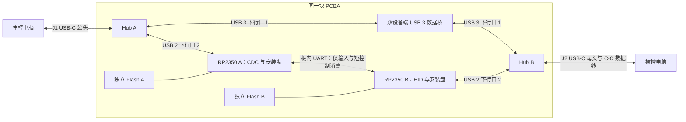

# WiredKVM 无无线 PCBA 预设计

> 历史备选方案：本文的 RP2350＋Hub＋USB 3 桥不是当前架构。现行要求以 [PCBA 需求规格书](PCBA_REQUIREMENTS.md) 为准：单 CH32V407 量产候选、CH32V467 开发板验证。保留本文作研究追溯，不据此设计或下单。

日期：2026-10-30。阶段：器件研究、功能分配与电路分区。**尚未生成可生产的原理图、PCB、Gerber 或采购 BOM。**

## 1. 结论

可以设计成一块 PCBA，保留 USB-C 公头接主控、USB-C 母头接被控的形态。Wi-Fi、蓝牙、天线均不需要。

优先评估 **2 × RP2350A + 2 × USB 3 Hub + 1 × 双设备端 USB 3 数据桥**。两颗 RP2350A 分别替代主控侧串口桥和被控侧 ESP32-S3。大文件不经过这两颗 MCU。

这是有资料支撑的架构选择，不是新硬件已经运行全部功能。当前 S3 固件不能直接烧入 RP2350；要移植 USB、串口、计时、存储和任务调度。现有桌面端的输入、边缘返回与剪贴板事务逻辑可以保留，设备识别和传输后端需要调整。

高速桥仍以 PL27A1 的 27A7 自定义传输模式为候选。未取得可用固件、完整协议和样品验证前，不冻结桥芯片，不下单 PCBA。该结论继承 [双接口可行性报告](HIGH_SPEED_TWO_PORT_FEASIBILITY_20261030.md)。

## 2. 为什么选 RP2350

| 方案 | 作用与限制 | 本次选择 |
|---|---|---|
| 两颗 RP2350A | 不集成 Wi-Fi/蓝牙。每颗提供一个原生 USB Device 接口。支持所需 HID、CDC、MSC | 首选验证；两端分别运行一个设备栈 |
| 两颗 RP2040 | 可复用更多现有桥代码；USB 已知问题需要按硅版本和 SDK落实处理 | 原型备选，不能忽略 E15 等 USB 勘误 |
| 单颗 STM32F723 | 有 FS 与 HS 两个 USB 控制器，可研究取代两颗控制 MCU | 后续精简候选；双 Device 并行、库实例和供电须验证 |
| ESP32-P4 | 不集成无线，具有一组 HS 和一组 FS USB，可较多复用 ESP-IDF | 可行候选；当前任务不需要其多媒体功能。双设备栈并行未验证 |
| 继续用 S3 但关闭无线 | 可维持当前实机基础 | 不符合“芯片本身无 Wi-Fi/蓝牙”的新选型目标 |

RP2350 官方资料列出 USB Device 的控制、批量和中断端点能力，并说明修正了 RP2040 的 USB 勘误。芯片自身仍有勘误，采购版本和 SDK 组合需要复核。它不是无缺陷保证。[RP2350 数据手册 §12.7](https://pip-assets.raspberrypi.com/categories/1214-rp2350/documents/RP-008373-DS-2-rp2350-datasheet.pdf?disposition=inline)

RP2350A 的 7 × 7 mm 封装和可选签名启动适合继续评估。原型可用不带 W 的 Pico 2；量产使用裸 MCU，不装附加无线芯片。签名启动是否启用另行设计，不在验证前烧写不可逆 OTP。[RP2350 官方规格](https://www.raspberrypi.com/products/rp2350/)、[Pico 系列与无线型号说明](https://www.raspberrypi.com/documentation/microcontrollers/pico-series.html)

STM32F723 与 P4 的两个接口均不是两个 USB 3 端口。若让文件依次经过一组 HS 和一组 FS，FS 会成为瓶颈。替换 MCU 不会自动替代 USB 3 数据桥。[ST 官方规格](https://www.st.com/en/microcontrollers-microprocessors/stm32f723vc.html)、[P4 官方 USB 文档](https://docs.espressif.com/projects/esp-usb/en/latest/esp32p4/usb_device.html)、[P4 无集成无线说明](https://developer.espressif.com/blog/2024/08/esp32-memory-map-101/)

## 3. 板内连接

每台电脑面对自己的 Hub 上行口。两台电脑都保持 USB Host 角色。桥有两个 USB Device 端口，不能用普通 Hub 代替。[PL27A1 数据手册](https://www.prolific.com.tw/wp-content/uploads/2025/07/DS-27131201-PL27A1_V1.5.pdf)

一颗 RP2350 只有一个原生 USB 控制器。双 MCU 方案避免依赖 PIO 模拟第二个 USB 端口。两颗可用同系列固件工程，按 A/B 角色配置；不需要为了对称而让两侧枚举相同接口。

两颗 Hub 可先参考 USB5742B，其 USB 2 与 SuperSpeed 控制器并行工作。它不是最终采购型号。桥的 USB 2 回退和 MCU 必须接不同的下行口，不能把 D+/D−并接。[USB5742B 数据手册](https://ww1.microchip.com/downloads/aemDocuments/documents/UNG/ProductDocuments/DataSheets/USB5742B-Data-Sheet-DS00002016.pdf)

## 4. 现有功能如何保留

| 功能 | 新硬件及软件承担位置 | 移植要求 |
|---|---|---|
| 未安装 Companion 就能控制被控机 | A 的 CDC → 板内 UART → B 的标准 HID | 主控应用已启动且有输入权限；HID 启动不等待文件桥 |
| 左键拖选、按键释放、上下滚动 | B 的相对与绝对 HID 接口 | 保留现有报告结构、按钮状态和滚动语义 |
| 自动边缘返回 | 主控坐标逻辑 + B 的绝对鼠标报告 | 保留协议命令与 ACK；验证多屏和缩放，不改成纯相对鼠标 |
| 拔线后恢复主控输入 | 两端 VBUS/挂起状态与主控超时处理 | 主控故障释放不能等待文件任务完成 |
| 双向文字、图片及单文件粘贴 | 两端应用 + USB 3 数据桥 | 保留复制来源与粘贴事务，替换传输层 |
| 两台机器内部复制粘贴 | 各自操作系统与本机应用 | 本机新复制优先；跨机响应不得覆盖更新的本地内容 |
| 设备内提供安装程序 | 两侧 Flash + 只读 MSC | 本地直读，不经过 UART；HID 先可用 |
| Finder 原生文件进度 | Mac Companion/主控端文件入口 | 保留已验证的系统交互，改造大文件流式接收 |
| Windows 跨系统操作 | Windows 输入与剪贴板适配层 | 硬件类接口可用不等于 Windows 应用已完成 |

“全部现有功能”指已确认的键鼠、边缘返回、双向文字与单文件功能。GB 文件、多文件、文件夹和完整 Windows 产品仍是开发项，不能因更换 MCU 宣称已经实现。

### USB 资源核对

按现有描述符，A 需要 CDC 通知 IN、CDC 数据 IN/OUT、MSC IN/OUT，共 5 个非零方向端点。B 需要相对 HID IN、绝对 HID IN、MSC IN/OUT、厂商 HID IN，共 5 个；厂商输出经 EP0。各端点独立于另一颗 MCU 的编号。

RP2350 支持 0–15 号各方向端点。现有组合在端点数量上可容纳。按每方向预留一个 64 B 硬件缓冲，5 × 64 B = 320 B；即使非零端点全双缓冲为 640 B，也低于 3840 B 可用空间。此项仅证明资源数量，不代替 TinyUSB 实际分配、枚举或时延测试。软件 MSC 的 512 B 扇区缓冲不是一个 512 B Full-Speed USB 数据包。[RP2350 数据手册 §12.7.1](https://pip-assets.raspberrypi.com/categories/1214-rp2350/documents/RP-008373-DS-2-rp2350-datasheet.pdf?disposition=inline)

### 现有代码依据

- `firmware/rp2040/`：已有 CDC、只读 MSC、UART 缓冲和构建基础；此前通过构建及隔离测试，未有实体 RP2040/RP2350 验收。
- `firmware/main/usb_hid.c`：相对、绝对和厂商 HID 分接口。保留独立绝对鼠标接口，避免拖选回归。
- `firmware/main/wire_protocol.c`：保留命令与帧校验，硬件相关层另作实现。
- `firmware/main/flash_setup.c`：ESP 分区和读盘 API 需要替换；安装资源的校验不能阻塞 HID 启动。
- `native/wiredkvm.cpp`：绝对坐标、输入 ACK、边缘返回和故障释放在桌面端。
- `host/clipboard/WKFilePortal.swift`：当前仍为 1 MiB 入口与完整对象等待，需改流式文件层。

以上是本次源码检查，不是本次构建或实机回归。

## 5. 电路分区与安装资源

| 分区 | 初步分配 | 设计约束 |
|---|---|---|
| J1、J2 | 公头与母头各 1，均作为面向电脑的设备端 | 独立 CC、VBUS 检测；公母头接法不能互抄 |
| HA、HB | USB5742B 或经验证的等效 USB 3 Hub 各 1 | 每侧至少 2 个内部下行口；独立上行、复位与支路控制 |
| MA、MB | RP2350A 各 1 | 两端 USB 标准设备；看门狗；独立 SWD/恢复测试焊盘 |
| FA、FB | 每侧暂按 16 MiB QSPI Flash 预留 | 保存固件与安装资源；按最终签名包核算，不沿用旧 2 MiB 假设 |
| BR | 双设备端 USB 3 桥 1 | 型号、Flash、固件与协议仍待锁定 |
| Type-C | 母座方向检测与 SS MUX；公头按参考电路处理 | 支持正反插；使用真正 USB 3 C-C 数据线 |
| 电源与保护 | 分区稳压、限流、防反灌、ESD | 两侧 VBUS 不直连；未上电 GPIO/UART 不反向供电 |

16 MiB 是容量预留，不是已经完成的分区表。RP2350 支持该数量级外部 Flash；还要核对启动兼容、固件双槽、资源回滚和剩余容量。两端分别保存需要的安装器，避免 USB 3 桥驱动尚未安装时取不到安装程序。

安装资源可以放 Flash；日常用户文件不能写进 MCU Flash。MCU Flash 不参与大文件转存。初次安装可以出现 Setup 入口，安装完成后按正常推出流程撤下；日常跨机粘贴不弹交换盘。

只读安装盘的 USB Full-Speed 仍有速度上限。换 MCU 本身不保证安装立刻完成。应保持安装器小、从本地 Flash 读取，并完成正式签名、公证及离线验证。安装盘先保持无介质也不能重置整个 USB 设备来撤盘，否则会断开 HID。

建议先按 4 层受控阻抗评估布局。若空间、回流或布线不满足，再比较 6 层。当前不冻结板长、板宽、连接器机械型号或报价。去掉无线不能证明整机一定更便宜；Hub、数据桥、高速布线和组装费用仍需询价。

## 6. 文件负载不拖慢输入

设计约束：

1. 大文件只通过 USB 3 桥。MCU/UART 只收有界输入与短消息。
2. 输入线程不等待文件队列、磁盘、哈希或传输 ACK。
3. 桥故障只复位桥；不复位 Hub 或 HID MCU。
4. 输入支路电源有余量；数据支路故障不能拖低输入电源。
5. 安装盘读取回调必须有界，USB 服务任务不能被长时间 Flash 校验占住。
6. 固件或资源擦写不在跨屏控制期间执行。XIP Flash 写入可能暂停取指，需专门更新流程。
7. 任一端退到 USB 2 时，检测并限速或暂停文件传输。主控 CDC 本身也用 Bulk，不能只说“有 HID 优先级就够”。

这些设计消除文件与 MCU 的直接争用。主机 CPU、USB 控制器与整机供电仍需满载验收。目标沿用前报告：文件传输时无卡键、无丢释放、无边缘返回回归，额外输入延迟 p99 ≤ 5 ms。该数值是待验证目标，不是当前成绩。

## 7. 从预设计到可打板文件

| 阶段 | 交付物 | 放行条件 |
|---|---|---|
| 本次 | 无无线架构、功能迁移表、候选物料表 | 已完成资料与源码检查 |
| 开发板验证 | 两块非 W Pico 2、两个成品 Hub、可编程数据桥组成样机 | 两端独立枚举、HID/安装盘、桥协议均可用 |
| 并行负载验证 | 自有收发程序、文件哈希、输入延迟记录 | 传文件不损坏输入；断开、取消和降速恢复正确 |
| 原理图 | 按页电路、确切料号/引脚、供电与启动预算 | 桥固件可取得；电路与器件勘误审查通过 |
| PCB | 布局布线、阻抗约束、ERC/DRC 与机械检查 | 信号、电源、热和正反插设计完成 |
| 小批打样 | Gerber、钻孔、坐标、正式 BOM、烧录与测试规程 | 设计审查完成；用户另行确认制造与费用 |

目前不需要先购买定制 PCBA。现有 S3 继续作为功能基线；非无线新样机单独验证，不覆盖正在使用的固件。

## 8. 附件与证据边界

- [候选功能 BOM](NO_RADIO_PCBA_CANDIDATES_20261030.csv)：数量为拓扑参考，不含全部外围，不可直接采购或生产。
- [前序可行性与供电审查](HIGH_SPEED_TWO_PORT_FEASIBILITY_20261030.md)：高速桥、功耗与 Type-C 的未决项仍有效。
- 本次没有烧录、购买、修改现有运行程序或创建 EDA 工程。
- 尚未证明 RP2350 新固件的实体连接、全部功能回归或大文件性能。
